# Marketing Brain

**A shelf video in, a reviewed catalog, ads, landing pages and search listings out. The AI proposes. The owner approves.**

Marketing Brain helps a small shop owner who has no marketing team. They film a shelf. The app reads the price tags,
builds a product catalog, picks what to promote, and writes safe, reviewed marketing for it: ads, a four-picture ad series,
a landing page, and search (SEO) text. Everything is a proposal. **Nothing goes live, nothing is sent to a shop or to Meta, and
no money is spent until the owner approves it.** Every action is logged and every change to a shop can be rolled back.

Built for the Meta hackathon on **Muse Spark** (`muse-spark-1.1`, text and vision) and **Muse Image** (`muse-image-1.0`)
through the OpenAI SDK at `https://api.meta.ai/v1`.

## Contents

1. [What it does](#what-it-does)
2. [The one rule: AI proposes, code checks, owner approves](#the-one-rule)
3. [Architecture](#architecture)
4. [The flows, one by one](#the-flows)
5. [Pricing words: MRP and Cost](#pricing-words-mrp-and-cost)
6. [Data model](#data-model)
7. [Models, calls and cost](#models-calls-and-cost)
8. [Guardrails](#guardrails)
9. [Evaluation](#evaluation)
10. [Setup](#setup)
11. [Connecting a shop](#connecting-a-shop)
12. [API map](#api-map)
13. [Repository layout](#repository-layout)
14. [What was tested and what was not](#what-was-tested-and-what-was-not)
15. [Known limits and roadmap](#known-limits-and-roadmap)

---

## What it does

| Feature | What the AI does | What plain code does | What the owner does |
|---|---|---|---|
| **Camera to catalog** | Reads every readable price tag in each video frame | Samples frames, merges repeat sightings, flags doubtful rows | Reviews and corrects the draft, approves |
| **Planner** | Picks 3 products to promote and explains why | Computes discount and stock from the catalog | Approves or rejects |
| **Ad draft** | Writes 3 ad lines, edits an image from the real product photo | Blocks risky claims, caps the budget | Picks one line, confirms claims, approves |
| **Ad series** | Writes one shared style and 4 scene pictures, 4 lines, one translation | Draws headline, price and button onto the pictures, scores colour consistency | Reviews the 4 pictures, approves |
| **Landing page** | Writes the words and optionally a hero image | Builds the page from a template, opens it in a real browser, measures it | Reads the screenshots and checks, approves |
| **SEO engine** | Proposes title, description, heading and image text, each with a reason | Checks limits, stuffing, prices and claims, builds product schema, applies and rolls back | Reviews a before and after diff, approves |
| **Send to a shop** | Nothing | Exports CSV or sends signed requests as drafts | Chooses the shop and publishes |
| **Kill switch** | Nothing | Refuses every approval, send, apply and model call | Presses one button |

<a id="the-one-rule"></a>
## The one rule: AI proposes, code checks, owner approves

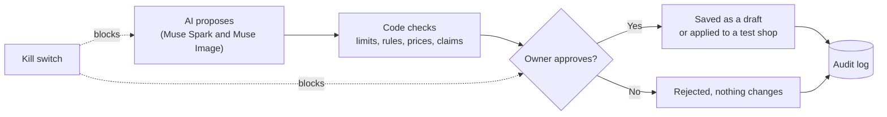

The model never decides anything that matters. Prices, stock, budgets, length limits, safety rules and layout are plain code
that can be read and tested. The model supplies words and pictures, and the owner has the last word.

## Architecture

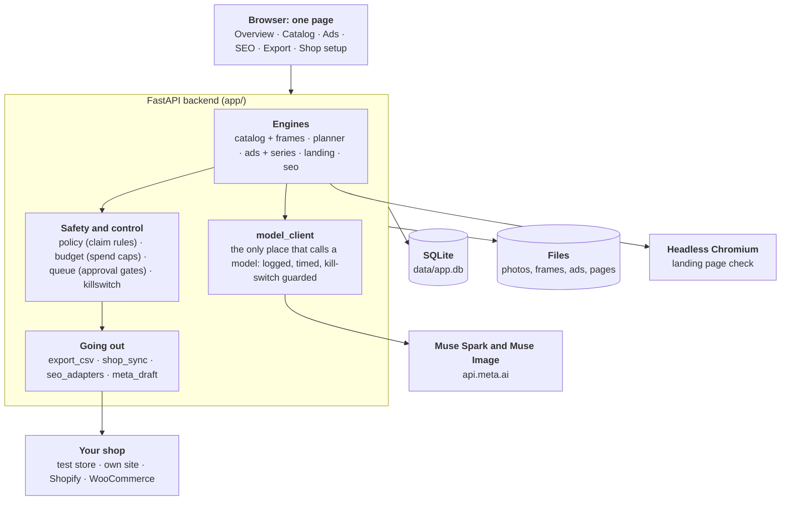

* **One model client.** Every model call goes through `model_client.py`, which logs the purpose, time and tokens (never the prompt,
  the image or the key) and refuses to run while the kill switch is on.
* **One approval queue.** Every proposal, whatever its kind, goes through `queue.py`, where each kind has its own gate.
* **Plain storage.** SQLite and local files. No external service is needed except the model API.

## The flows

### 1. Camera to catalog

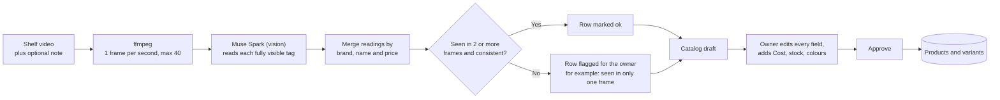

The same product appears in many frames, so readings are merged by what the tag says, not by how the item looks. Agreement
across frames is the free quality check. A product read once, or read two different ways, is flagged instead of trusted.
Repeat imports do not create duplicates.

### 2. Planner and ad engine

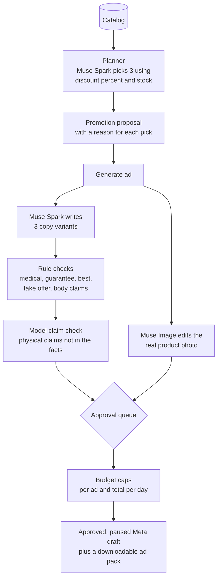

A blocked line cannot be approved. A line with a claim we cannot verify needs the owner to confirm it. No price means no ad.
Nothing is sent to Meta: an approved ad is kept as a paused draft with a pack to upload by hand.

### 3. The approval queue

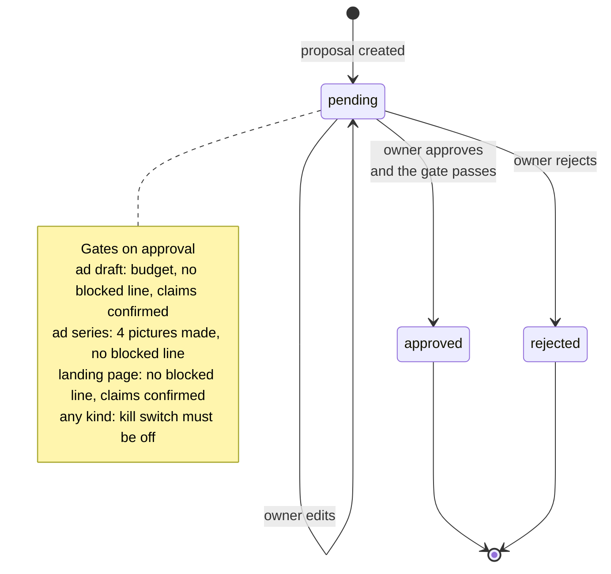

Kinds in the queue: `promotion`, `ad_draft`, `catalog_draft`, `ad_series`, `landing_page`. SEO changes have their own
table and their own approve, apply and roll back steps (below).

### 4. Ad series: four pictures, one look

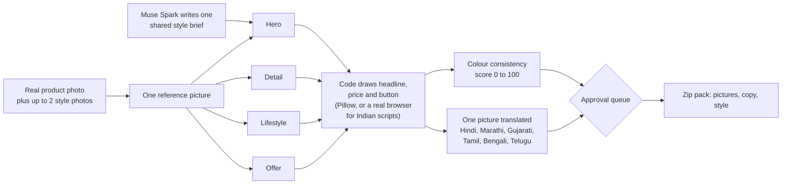

The same style brief goes into all four prompts, and every picture is made from the same real photo. Text is drawn by the app,
never by the image model, so the price and wording are always correct. A failed picture is retried once and then shown as
failed, and a series with a missing picture cannot be approved.

### 5. Landing page with a real browser check

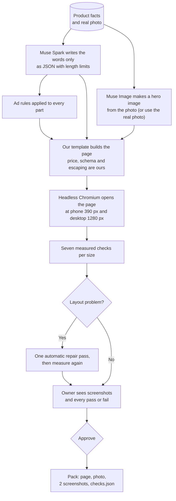

The seven checks: the page loads with no errors, nothing scrolls sideways, the photo loads and is visible, the headline, price and
button are visible without scrolling, text contrast is at least 4.5 to 1, the button is at least 44 by 44 px, and nothing covers
the price or the button. A failed check is shown in red and never hidden. Without a buy link the button is a clearly labelled
placeholder, never a fake checkout.

### 6. SEO engine: propose, diff, apply, roll back

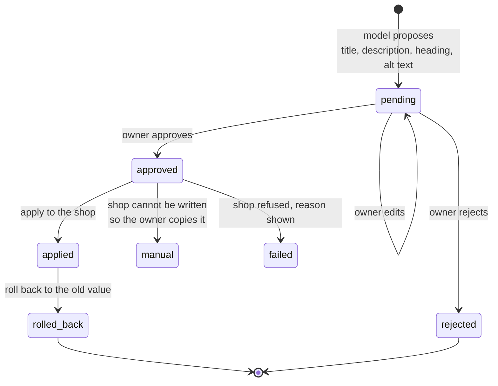

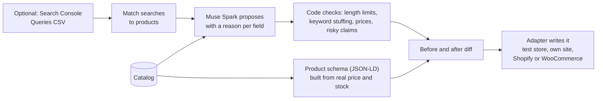

The previous value is stored, so every applied change can be rolled back. If the live value changed since the proposal was made,
the engine reports a conflict instead of overwriting it. Fields a shop cannot accept through its API (for example Shopify page
heading and schema) are shown for the owner to copy, and the engine says so plainly.

### 7. Sending products to a shop

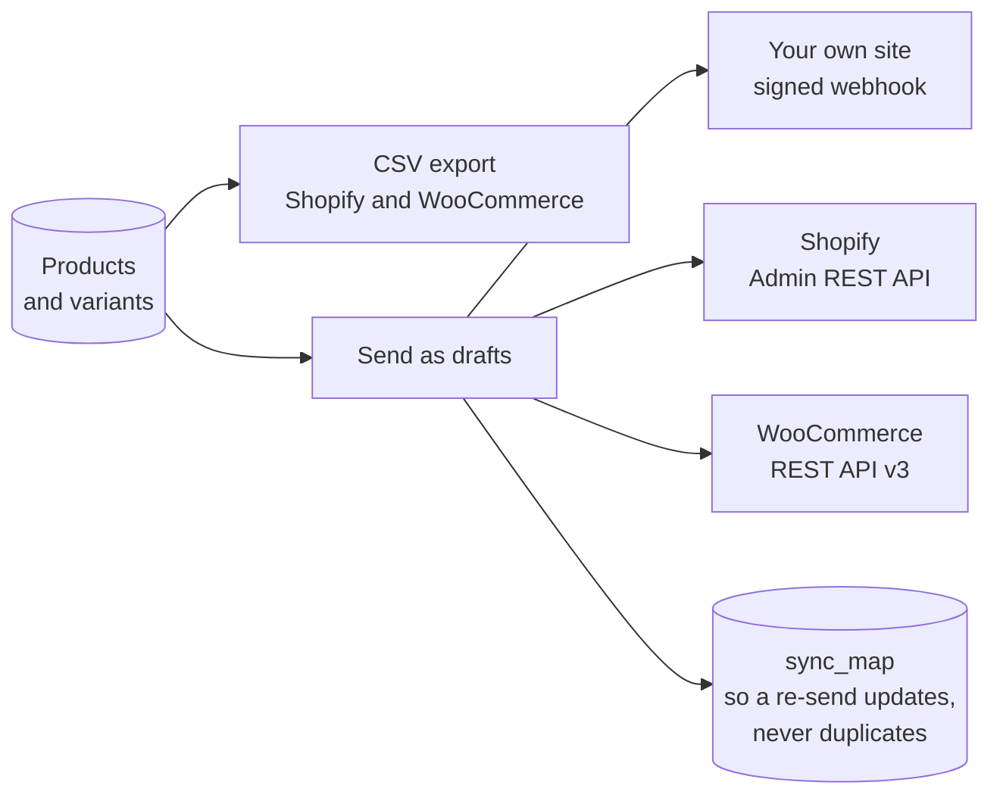

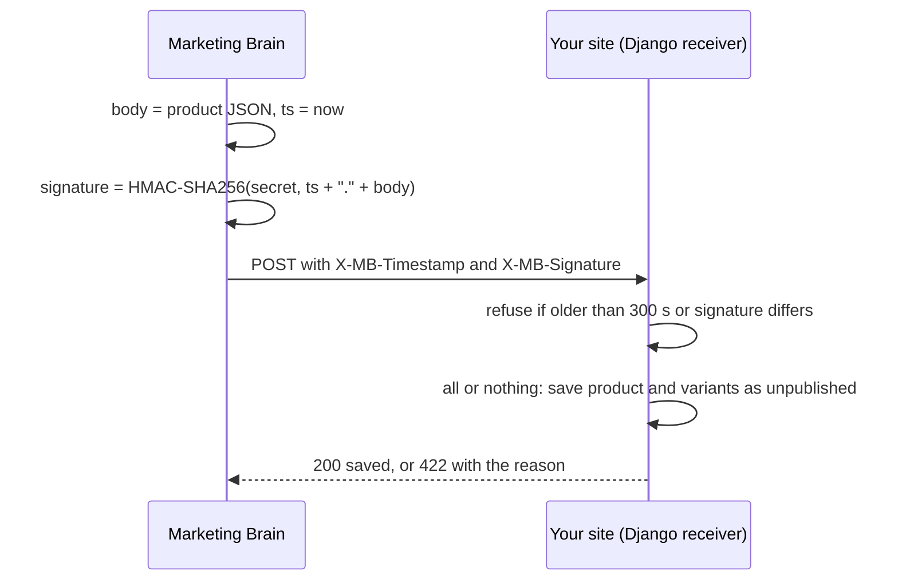

Products arrive unpublished unless the owner chooses live. The sender never follows redirects, requires https (except
localhost), retries only timeouts, 429 and 5xx, and never logs a secret. The example receivers in `docs/` never create
categories, fabrics or colours: if one is missing, the product is refused with a message that names what to add first.

### 8. Kill switch

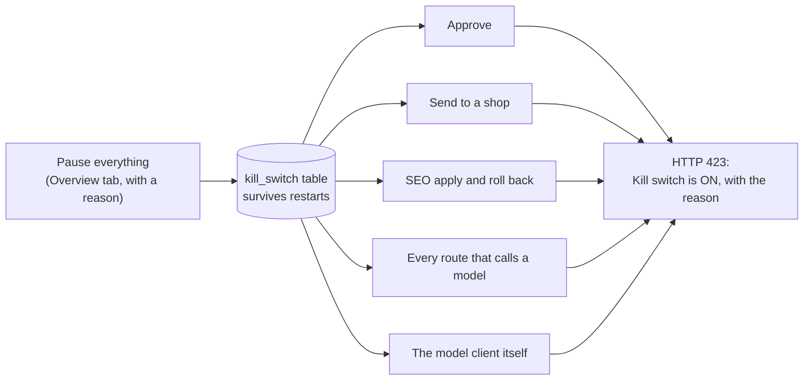

While paused, the owner can still read, edit drafts, reject, download CSV files and read the audit log. The model client also
refuses to call a model, so even a route that forgot the guard cannot spend anything.

## Pricing words: MRP and Cost

These are the owner's words, used the same way everywhere (ads, exports, sends, landing pages, planner).

| Word | Meaning | Database field |
|---|---|---|
| **MRP** | The printed maximum price | `price` |
| **Cost** | What the customer actually pays | `cost` |

The price shown to customers is the Cost when one is set, otherwise the MRP. The MRP is shown struck through only when it is
higher. The planner uses discount percent and stock. There is no buying-cost or margin figure.

## Data model

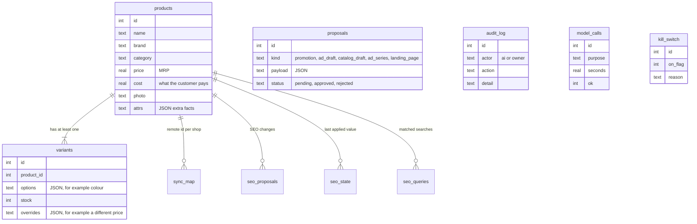

A product holds what is shared, and a variant stores only what differs. Every product has at least one variant, so stock is always
the sum over its variants.

## Models, calls and cost

| Step | Model | Calls |
|---|---|---|
| Frame sampling | ffmpeg (no model) | none |
| Reading price tags | `muse-spark-1.1` (vision) | 1 per frame, default 1 per second, max 40 |
| Planner | `muse-spark-1.1` | 1 per run |
| Ad copy and claim check | `muse-spark-1.1` | 2 per ad, plus 1 per edit |
| Ad image | `muse-image-1.0` | 1 per ad (edit from the photo, or generate if there is no photo) |
| Ad series | both | 1 style, 1 copy, 4 images (each retried once), 1 claim check, 1 per translation |
| Landing page | both | 1 copy, 1 claim check, 1 hero image |
| SEO | `muse-spark-1.1` | 1 per product (one retry if a check fails) |

Everything else is plain code: prices, margins, budgets, rule checks, merging, layout, measuring. Every call is logged with its
purpose, time and tokens (never the prompt, image or key), and the Report card shows the totals. Set `COST_TEXT`, `COST_VISION`
and `COST_IMAGE` to see cost numbers.

## Guardrails

| Risk | What stops it |
|---|---|
| The AI makes something go live | Everything is a proposal. Approving an ad saves a paused draft. Nothing is sent to Meta. Shop sends arrive unpublished |
| Overspending | Cap per ad (`MAX_DAILY_BUDGET`) and a cap on all approved ads together (`MAX_TOTAL_DAILY_BUDGET`), enforced in backend code |
| False or risky claims | Rule blocks for medical claims, guarantees, "best" or "#1", fake offers and body claims, plus a model check for physical claims not in the product facts. The owner must confirm those |
| Invented facts | The model only sees the catalog facts. Prices are never taken from model text: a landing page refuses any price, delivery, return or review wording |
| Wrong picture of the product | Images are edited from the product's own photo. The screen says whether the image is real or generated. If editing fails, the real photo is used and labelled |
| Wrong text in pictures | Headline, price and button are drawn by code, not by the image model |
| A bad import | Video paths are restricted, repeat imports do not duplicate, drafts keep their own photos |
| A bad send to a shop | Signed requests, a 5 minute window, https only, no redirects, all-or-nothing saves, drafts by default, idempotent re-sends |
| A bad SEO change | Before and after diff, owner approval, conflict detection, one-click roll back |
| Something goes wrong | The kill switch pauses everything. Every action is in the audit log |

## Evaluation

One run on a 14-product test shelf (10-second video), compared with a hand-labelled list.

| Measure | Result |
|---|---|
| Products found | 14 of 14 (100%) |
| Draft items that were real products | 14 of 14 (100%) |
| Name, brand and price all correct | 13 of 14 (92.9%) |
| Price correct | 100% |
| Wrong items flagged for the owner | 1 of 1 |
| Model calls | 10 (0.71 per product) |
| Time to build the draft | 85.4 s |
| Time to list 14 products by hand | 1680 s (assumed 120 s per product, not measured) |

The one error was a misread name (`LINEN SHRT` for `LINEN SHIRT.`). It was flagged "seen in only one frame", so the owner is told
to check it. The cost per call was not measured in this run.

**Limits of this result:** a single run on one AI-generated video with clear tags. Real footage will do worse, so treat these as an
upper estimate. Reproduce it with `eval/run_eval.py` (see [Running the evaluation](#running-the-evaluation)).

## Setup

You need Python 3.10 or newer and ffmpeg (Windows: `winget install Gyan.FFmpeg`, then reopen the terminal).

```
python -m venv .venv
.venv\Scripts\Activate.ps1
pip install -r requirements.txt
copy .env.example .env
```

If PowerShell blocks the activate script, run `Set-ExecutionPolicy -Scope Process Bypass` first. Open `.env`, set `MODEL_API_KEY`, then:

```
uvicorn app.main:app --reload
```

Open http://127.0.0.1:8000. If the app says the database is in the old format, delete `data/app.db` and start again.

**Optional, for the landing page check and translated ad text:** a real browser.

```
pip install playwright
playwright install chromium
```

### Settings in `.env`

| Name | Default | Meaning |
|---|---|---|
| `MODEL_API_KEY` | none | Required |
| `MODEL_BASE_URL` | `https://api.meta.ai/v1` | API address |
| `MODEL_NAME`, `IMAGE_MODEL_NAME` | `muse-spark-1.1`, `muse-image-1.0` | Models |
| `MAX_DAILY_BUDGET`, `MAX_TOTAL_DAILY_BUDGET` | 500, 1000 | Spend caps, Rs per day |
| `FRAME_FPS`, `MAX_FRAMES`, `FRAME_MAX_WIDTH` | 1.0, 40, 1280 | Frame sampling |
| `COST_TEXT`, `COST_VISION`, `COST_IMAGE` | 0 | Cost per call, for the cost numbers |
| `WEBHOOK_URL`, `WEBHOOK_SECRET` | none | Your own site |
| `SHOPIFY_STORE`, `SHOPIFY_TOKEN` | none | Shopify |
| `WOO_URL`, `WOO_KEY`, `WOO_SECRET` | none | WooCommerce |
| `SYNC_IMAGE_BASE` | none | Public address where product photos are hosted |
| `SEO_TITLE_MAX`, `SEO_DESC_MAX`, `SEO_H1_MAX`, `SEO_ALT_MAX` | 60, 155, 70, 125 | SEO length limits |
| `SEO_PLUGIN` | none | WooCommerce only: `yoast` or `rankmath` |
| `SERIES_FONT` | auto | A `.ttf` file for text on ad series pictures, if none is found |

Real environment variables override `.env`, so remove any you set in your terminal.

### Running the evaluation

1. Copy `eval/labels.example.csv` to `eval/labels.csv`, one row per product copied exactly from the tags.
2. From the repo root:

```
python eval\run_eval.py --video path\to\shelf.mp4 --labels eval\labels.csv --manual-seconds-per-product 120
```

It writes `eval/results.md` and `eval/results.json`. Add `--review-seconds-per-product N` once you have timed your own review.

## Connecting a shop

| Shop | How | Status |
|---|---|---|
| **Test store** | Built in, kept in the local database | Use it to try SEO apply and roll back with no setup |
| **Your own site** | Signed webhook to a receiver. Examples for Django in `docs/` | Tested against a real Django project built from a real store's models |
| **Shopify** | CSV import, or Admin API with a custom app token | Tested against a simulated Shopify only |
| **WooCommerce** | CSV import, or REST API v3 with a key and secret | Tested against a simulated WooCommerce only |

To try your own site locally: add `docs/django_receiver_catalog.py` (or the generic `docs/django_receiver.py`) to your project, add
its URL, set the same `WEBHOOK_SECRET` on both sides, set `WEBHOOK_URL` in `.env`, restart both, and use **Send to your own site**
on the Export tab. Products arrive unpublished. The receiver refuses a product whose category, fabric or colour does not exist
yet, and tells you which.

## API map

| Area | Routes |
|---|---|
| Catalog | `POST /catalog/upload`, `POST /catalog/from-video`, `PUT /catalog/draft/{id}` |
| Products | `GET/POST /products`, `PATCH /products/{id}`, variants under `/products/{id}/variants` |
| Planner and ads | `POST /planner/run`, `POST /ads/generate`, `PUT /ads/draft/{id}` |
| Ad series | `POST /series/generate`, `PUT /series/{id}`, `POST /series/{id}/localize`, `GET /series/{id}/pack` |
| Landing page | `POST /landing/generate`, `PUT /landing/{id}`, `GET /landing/{id}/page`, `/shot/{phone,desktop}`, `/pack` |
| Queue and log | `GET /proposals`, `POST /proposals/{id}/approve`, `.../reject`, `GET /audit` |
| SEO | `POST /seo/generate`, `GET /seo/proposals`, approve, `POST /seo/apply`, rollback, `POST /seo/queries/import` |
| Shops | `GET /export/{shopify,woocommerce}.csv`, `GET /sync/config`, `POST /sync/{shop}` |
| Meta drafts | `GET /meta/drafts`, `GET /meta/drafts/{id}/pack` |
| Control and report | `GET/POST /killswitch`, `GET /report` |

Interactive API docs are at http://127.0.0.1:8000/docs while the app runs.

## Repository layout

```
app/
  main.py            app and routers
  model_client.py    every model call, logged and kill-switch guarded
  catalog.py         frames to catalog draft (merge, flags)       frames.py  ffmpeg sampling
  catalog_api.py     upload and draft routes
  products.py        products, variants, MRP and Cost rule
  planner.py         picks 3 products
  ads.py             ad copy and image         series.py   four-picture series and translation
  landing.py         landing page and browser check
  seo.py             SEO engine                seo_adapters.py   how each shop is read and written
  policy.py          claim rules               budget.py   spend caps
  queue.py           approval queue and gates  killswitch.py   emergency stop
  export_csv.py      CSV export                shop_sync.py    signed webhook, Shopify, WooCommerce
  meta_draft.py      paused ad drafts and packs
  report.py          counts, spend, timing     calllog.py  model call log      audit.py  audit log
static/index.html    the single-page interface
docs/                example receivers for your own site (Django)
eval/                evaluation script, labels template and results
samples/             sample shelf pictures
test_landing.py      landing page tests
```

## What was tested and what was not

**Tested, with real code paths and fake model answers:** catalog merge and flags, MRP and Cost rules, ad rules and gates, CSV export,
signed sends with retries and duplicate protection, the SEO engine (limits, diff, apply, conflict, roll back), the ad series
(consistency, translation, retries, gates), the landing page (measured checks in a real Chromium, repair pass, gates), the kill
switch (every guarded route returns 423 while on, and the model client refuses too), and a real Django project built from a real
store's models receiving signed products.

**Tested against simulated shops only:** Shopify and WooCommerce. Their field names follow the public REST docs but have not been run
against a real store.

**Not tested:** behaviour with the live model under heavy load, and picture quality across many products (judged by eye, not
measured). The consistency score is a colour-histogram measure, a rough guide and not a judgement of style.

## Known limits and roadmap

**Known limits**

* One shop and no login. It is meant to run on the owner's own machine.
* Nothing is sent to Meta. Approved ads are paused drafts with a pack to upload by hand.
* Products are merged by the text on the tag. A product that is never seen is not flagged. Only the evaluation's recall shows misses.
* Reading frames one at a time takes about 8 seconds a frame.
* Ad copy and claim rules are English only. Our checks are not Meta's ad policy.
* The ad series keeps a consistent look through a shared style brief and one reference picture. The image model takes a single
  reference image, so how closely it follows extra style photos is not guaranteed.
* Shopify heading and schema, and WooCommerce schema, cannot be written through their APIs, so they are shown for the owner to copy.
  WooCommerce title and description need `SEO_PLUGIN`.
* No Search Console connection: the owner uploads the Queries CSV by hand.
* SQLite only, with no migrations.
* Evaluated on one clean test video, so treat the numbers as an upper estimate.

**Roadmap (not built)**

* Whole-store context for the planner, with a measured cost and speed comparison.
* Competitor ad clip analysis into a validated structured summary.
* Demand forecast against a naive baseline, with an honest fallback when there is no order history.
* Direct Search Console connection, real-shop runs for Shopify and WooCommerce, and sending drafts to Meta through the Marketing API.